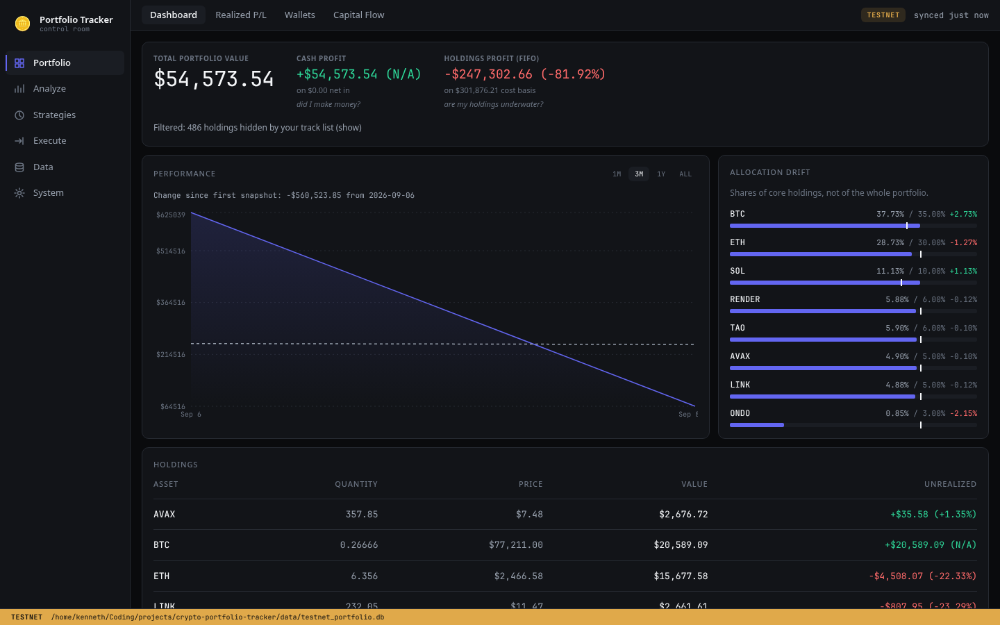
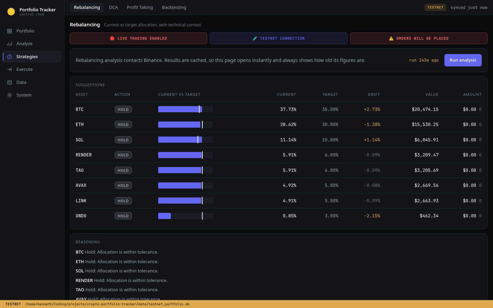
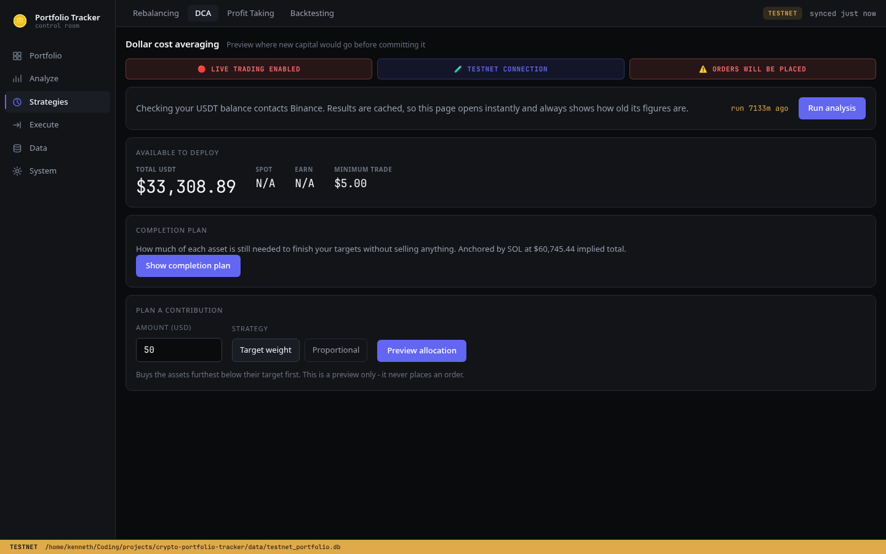
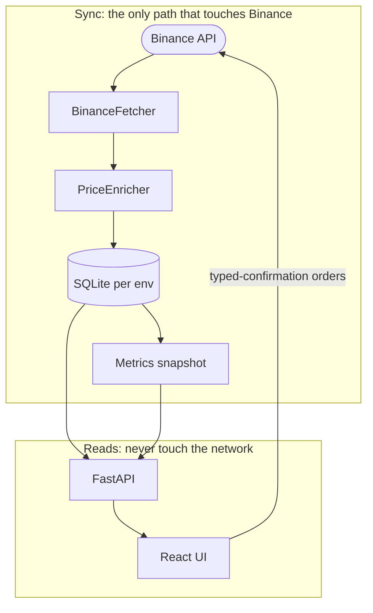
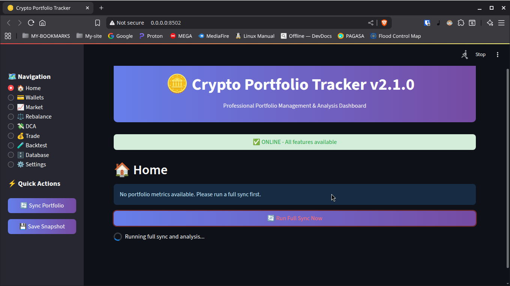

<p align="center">
  
</p>

<h1 align="center">Crypto Portfolio Tracker</h1>

<p align="center">
  <b>Know exactly where your crypto stands, and what to do next.</b><br>
  Syncs your full Binance history, values every holding two honest ways,
  and turns multi-timeframe analysis into rebalancing trades you confirm and place yourself.
</p>

<p align="center">
  
  
  
  
  
  
</p>

<p align="center">
  
</p>

---

## Why another tracker?

Most trackers give you one P/L number and hope you never ask questions. This one was built
for real money, so it follows one rule throughout: an unknown value is never presented
as a known one. A missing price renders as unknown, never as a confident and wrong $0.00.

- **Two accounting models, side by side.** FIFO cost basis answers "are my holdings
  underwater?", net invested capital answers "did I actually make money?".
  On real portfolios these routinely differ several-fold, so both are shown, labelled,
  and never averaged together.
- **Rebalancing that respects the market regime.** A bear market (BTC below its SMA200)
  can suppress buys, majors (BTC/ETH) get tighter drift thresholds than alts, and every
  suggestion ships with its technical reasoning attached. Execution is typed-confirmation
  plus one click, or dry run.
- **Safe by construction.** Binds to localhost only, testnet gets its own database plus
  its own banner color, and live orders stay behind an explicit config gate.

## Screenshots

| Rebalancing: current vs target with drift | DCA: fund a plan, preview the fills |
|---|---|
|  |  |

*Captured against Binance testnet. The amber TESTNET strip and per-database banners exist
so testnet figures can never be mistaken for real money.*

## Features

- **Complete Binance sync.** Spot, P2P, deposits, withdrawals, Simple Earn, staking,
  converts, transfers. Incremental after the first run; price caching cuts repeat
  price API calls by roughly 90%.
- **Dual P/L.** Per-asset FIFO unrealized plus portfolio-wide net invested, with P2P sells
  correctly counted as cash-outs to fiat.
- **Rebalancing engine.** Core-sleeve targets, drift thresholds, support and resistance
  aware sizing, typed-confirmation market execution or dry run.
- **DCA planner.** Proportional or target-weight fills with balance validation.
- **Profit-taking radar.** Multi-factor scoring finds gains to lock in without touching
  the core position.
- **Backtesting.** Validate rebalancing strategies before trusting them with funds.
- **Multi-timeframe TA.** 4-year, 3-month and 60-day trend with RSI, MACD and SMA regimes.
- **Reports.** Excel, mobile-friendly HTML and full CSV backups.

## Quickstart

```bash
# 1. Prereqs: uv + Node.js + a Binance API key (read-only is enough to start)
cp .env.example .env        # then fill in MAIN_API_KEY / MAIN_API_SECRET

# 2. Install and launch (builds the UI, serves everything on :8000)
uv sync
./start.sh
```

Open http://127.0.0.1:8000. Start on testnet: flip **Binance testnet mode** in
Settings, then Sync, then explore freely. The React UI is the primary interface.

```bash
./start.sh --dev    # Vite on :5173 plus API reload, for UI work
```

## How it works

One process, one port, one SQLite file per environment. Sync is the only thing that
touches the network. Every screen reads the local database plus a JSON metrics snapshot,
so pages open instantly and an offline read shows last synced figures instead of zeros.



The Python core (`src/`) is load-bearing and handles real money, so the API layer wraps
it without modifying it. Targets are shares of the **core sleeve** (assets actively
rebalanced), not of the whole wallet, and every drift display uses that same denominator.

## Project structure

```
src/crypto_portfolio_tracker/  core: sync, pricing, analysis, execution
api/                           FastAPI layer: routes/, schemas/, cache, sync runner
frontend/                      React 19 + Vite + TypeScript + Tailwind
tests/  tests/api/             pytest suite for the core and the API layer
config/  data/  logs/          runtime config, SQLite DBs, app logs
```

## Development

```bash
uv run pytest -q                           # Python tests
uv run ruff check api tests/api run_ui.py  # lint
cd frontend && npx vitest run              # React tests
cd frontend && npx tsc -b                  # typecheck
```

## Also included: Streamlit classic and CLI

The original Streamlit dashboard still works (frozen now: breakage fixes only, no new
features), and the CLI covers debugging plus automation. Same core underneath, same
dual accounting.



```
==================================================
🪙 Crypto Portfolio Tracker v2.1.0
==================================================
1. 🔄 Full Sync & Analysis
2. 💰 Quick Portfolio Summary
3. 📈 View Trends
4. ⚖️  Rebalance
5. 💸 Dollar Cost Averaging (DCA)
6. 🔀 Trade
7. 💵 Transfer Funds
8. 🧪 Backtest
9. 📋 Reports
10. 📊 Charts
11. 🗄️  Database
12. 🧹 Data Cleanup
13. ⚙️  View Configuration
14. 🔧 Test Connections
15. ❌ Exit
==================================================
```

```bash
uv run track-portfolio-web   # Streamlit classic UI
uv run track-portfolio-cli   # interactive CLI (menu above)
```

## Safety and honesty notes

- **Localhost only, no accounts, no auth, by design.** The app holds trading-capable
  API keys, so it is not built to face a network. Never commit `.env` (`chmod 600 .env`).
- **Start on testnet and stay in dry run until ready.** `testnet_mode` switches endpoint
  plus database without a restart, `live_trading_enabled` gates real orders. Prefer
  read-only keys unless trading is actually needed.
- **Exchange history has limits.** Binance serves trailing windows (about 90 days for
  most transaction types), so very old cost basis can be incomplete. Cross-check against
  exchange records for anything tax relevant.

## Roadmap

- [x] React frontend over a FastAPI layer (shipped, now the primary UI)
- [ ] Manual transaction import from CSV (first step toward exchange-agnostic tracking)
- [ ] Multi-exchange support (live sync beyond Binance through one normalized schema)
- [ ] Exchange-free tracking (manual holdings and self-custody wallets, no exchange
  account needed)
- [ ] Real-time price alerts
- [ ] Deeper futures tracking

## Disclaimer

A personal tool for tracking my own portfolio. Not financial advice. Crypto is risky,
this software is MIT-licensed "as is", and rebalancing suggestions are computed output,
not recommendations.

## Acknowledgments

Binance (API plus testnet), CoinGecko (prices), yFinance (fiat rates), and the
[uv](https://github.com/astral-sh/uv) and [Ruff](https://github.com/astral-sh/ruff) teams.
